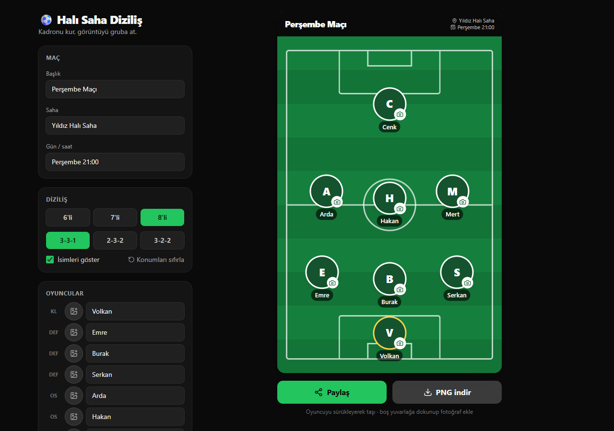
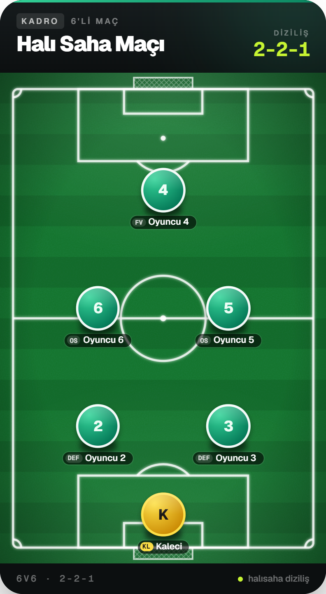

# ⚽ Halı Saha Diziliş

**Halı saha kadronu kur, oyuncu fotoğraflarını ekle, dizilişi tek dokunuşla WhatsApp grubuna at.**

React · Vite · Tailwind CSS · html-to-image · kurulum ve hesap gerektirmez

> *English summary:* a mobile-first lineup builder for 6/7/8-a-side amateur
> football. Pick a formation, drag players, add photos (auto-resized so they fit
> in browser storage), add match info, then **share the lineup as an image**
> via the native share sheet (WhatsApp, Instagram…) or download it as a PNG.
> Everything stays in the browser; no backend, no sign-up.

<p align="center">
  
  &nbsp;
  
</p>

## Hangi problemi çözüyor?

Her hafta maç öncesi WhatsApp grubunda "kim nerede oynuyor" tartışması olur;
birisi Paint'te saha çizer ya da isimleri alt alta yazar. Bu uygulama ile kadro
bir dakikada kurulur ve **gruba atılmaya hazır, temiz bir görüntü** olarak paylaşılır.

## Özellikler

- 🏟️ **3D saha:** kafesli halı saha, kaleler ve projektörlerle; fareyle/parmakla 360° döndür, tekerlek/iki parmakla veya sürgüyle yakınlaştır. Hazır kamera açıları (kale arkası, kuş bakışı, tribün), otomatik döndürme. Oyuncular 3D'de de sürüklenir, yer değiştirir; PNG o anki 3D açıyla çıkar
- 🧩 **6'lı, 7'li ve 8'li** kadrolar, her biri için 3 hazır diziliş
- ✋ **Sürükle-bırak:** oyuncu kaldırınca büyür, gölgesi yerden ayrılır, gidiş yönüne eğilir; bırakınca yaylı bir hareketle oturur (fare, dokunmatik ve ok tuşları). Konum diziliş başına hatırlanır
- 🔁 **Yer değiştirme:** bir oyuncuyu diğerinin üstüne bırak, yerleri değişsin; yedek kulübesinden sahaya sürükleyerek oyuncu değiştir
- 🧲 **Mıknatıslı yerleşim:** dizilişin varsayılan noktasına yaklaşınca oyuncu oraya oturur; sürüklerken rota ve hizalama çizgileri görünür
- ↩️ **Geri al:** taşıma, değişiklik ve diziliş değişiklikleri geri alınabilir (Ctrl+Z)
- 👕 **Forma rengi ve kaptan:** 7 forma rengi, kaptan bandı
- 📸 **Oyuncu fotoğrafı:** fotoğraflar kare kırpılıp 256 px WebP'ye küçültülür (3-5 MB'lık telefon fotoğrafı → ~15 KB)
- 📝 **Maç bilgisi:** başlık, saha, gün/saat görüntünün üstünde yer alır
- 📤 **Paylaş:** telefonda yerel paylaşım menüsü (WhatsApp, Telegram, Instagram…), desteklenmeyen tarayıcıda otomatik PNG indirme
- 🖼️ **PNG indir:** 2x çözünürlük, arayüz öğeleri (kamera rozetleri) görüntüye girmez
- 💾 **Otomatik kayıt:** her şey tarayıcıda (localStorage) saklanır; sayfayı kapatıp açınca kadro yerinde
- 📱 **Mobil öncelikli:** dikey saha, telefonda tek elle kullanılabilir

## Hızlı başlangıç

```bash
git clone https://github.com/idrishannn/halisaha-dizilis.git
cd halisaha-dizilis
npm install
npm run dev          # http://localhost:5173
```

```bash
npm test             # birim testleri (vitest)
npm run build        # üretim derlemesi -> dist/
```

### Yayınlama

Statik bir sitedir; `dist/` klasörü herhangi bir statik barındırmada çalışır.
Vercel: depoyu içe aktar → Framework: **Vite** → Deploy.

## Proje yapısı

```
src/
  App.jsx              Arayüz, paylaşma/indirme
  components/Pitch.jsx Saha ve sürüklenebilir oyuncu
  formations.js        6/7/8'li dizilişlerin koordinatları
  state.js             Saf durum fonksiyonları + localStorage (test edilir)
  image.js             Fotoğraf kırpma/küçültme
tests/state.test.js    Dizilişler, sürükleme, kayıt, eski sürümden veri taşıma
```

## Teknik notlar

- **Sürükleme**, kütüphane yerine Pointer Events ile yazıldı; fare, dokunmatik ve
  kalem aynı kodla çalışır, konumlar sahaya göre yüzde olarak tutulur (ekran
  boyutundan bağımsız).
- **3D görünüm** three.js + @react-three/fiber ile yapıldı ve ayrı bir parça olarak yalnızca 3D açıldığında indirilir; 2D kullanan için uygulama boyutu değişmez. WebGL yoksa otomatik 2D'ye döner.
- **Depolama kotası:** localStorage ~5 MB'tır. Fotoğraflar küçültülmeden
  kaydedilseydi 2-3 fotoğrafta dolardı; kota yine de dolarsa kullanıcı uyarılır.
- **Geriye uyumluluk:** ilk sürümün (`halisaha_players`) verisi otomatik taşınır.

## Lisans

MIT
